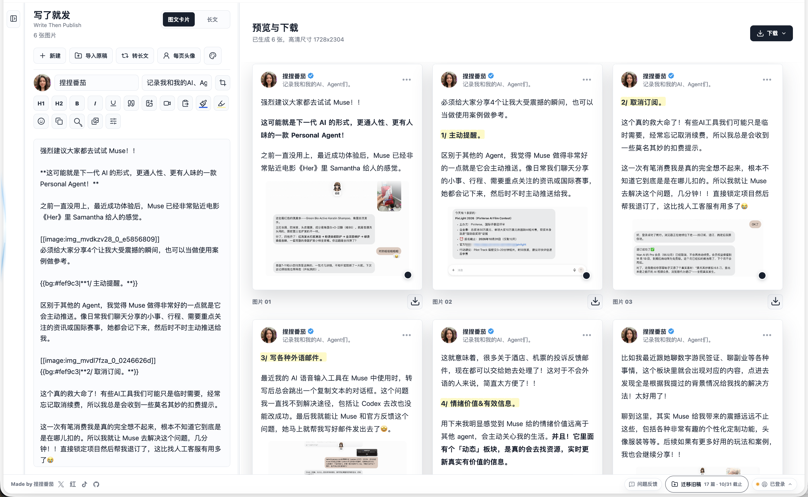
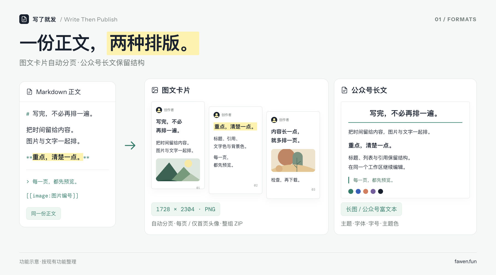
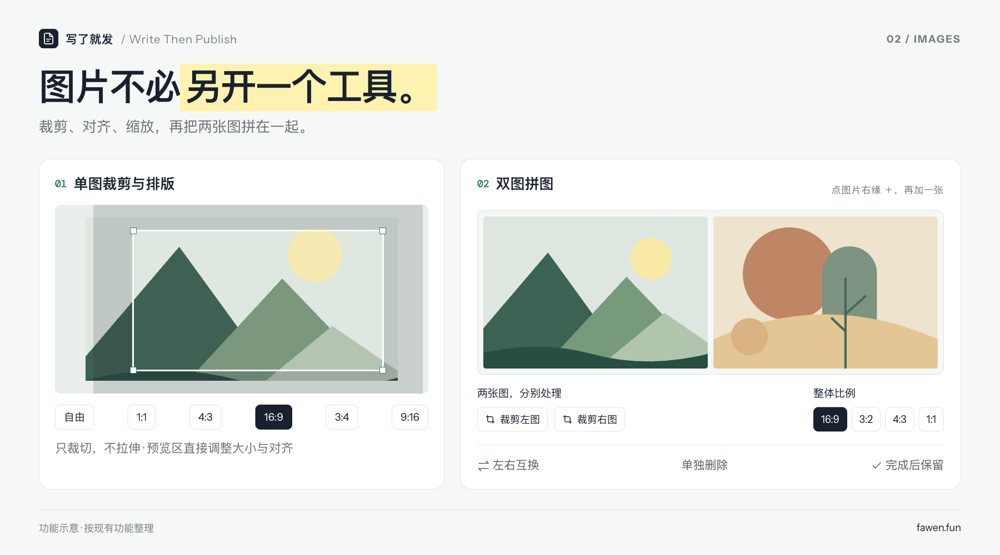
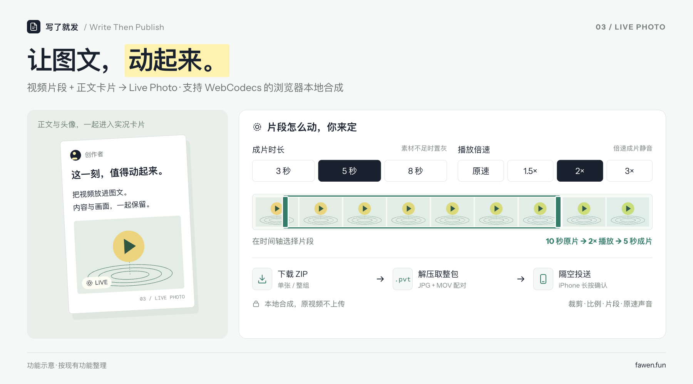
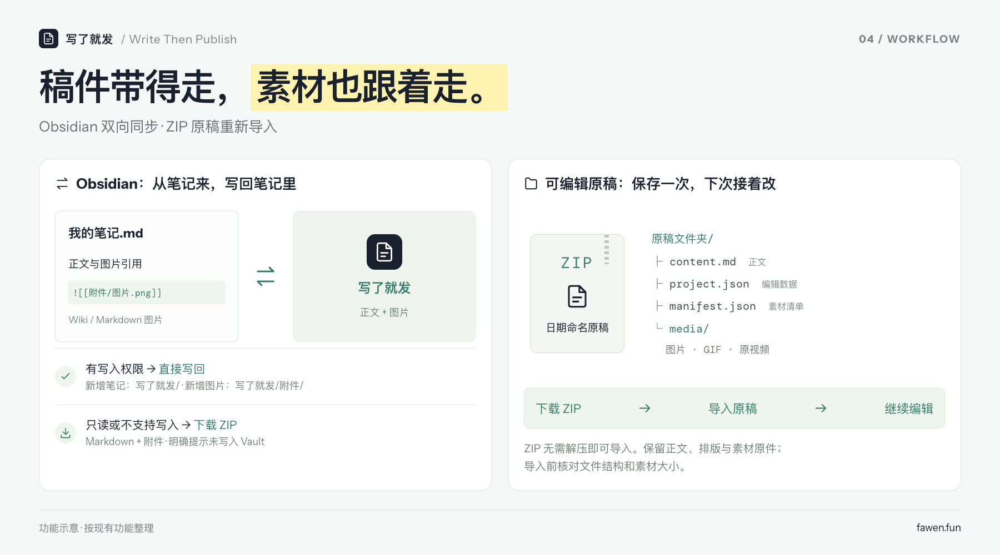

<div align="center">

# 写了就发

**Write Then Publish**

### 写完，不必再到处排版。

一份正文，排成图文卡片或公众号长文。图片、拼图、Live Photo、预览和导出，都在同一个工作区完成。

**[在线使用 →](https://fawen.fun)** · [核心功能](#核心功能) · [本地运行](#本地运行) · [能力矩阵](#能力矩阵)

[](LICENSE) [](#技术与边界) [](#live-photo)

</div>

<p align="center">
  
</p>

**左边写，右边自动排。** 上图为实际工作区：同一篇正文自动生成 6 张卡片，图片与文字一起分页，标准图片导出尺寸为 `1728 × 2304`。

从粘贴正文到下载成品：**写内容 → 选排版 → 加素材 → 预览 → 导出**。

## 核心功能

以下四张为依据现有功能制作的设计示意图；上方工作区为实际截图。

### 一份正文，两种排版

<p align="center">
  
</p>

| 图文卡片 | 公众号长文 |
|---|---|
| 正文与图片自动分页，逐页预览 | 保留标题、列表、引用、代码、表格与图片 |
| 支持头像昵称、标题、加粗、下划线、文字色与背景色 | 可选主题、字体、字号与主题色 |
| 头像可每页显示，也可仅在首页显示 | 下载 PNG 长图，或复制带内联样式的公众号富文本 |
| 单张 PNG 或整组 ZIP 下载 | 配置完成的 macOS 本地版可同步到公众号草稿箱 |

卡片和长文共用正文，切换输出形式后可以继续编辑。工具栏还支持**复制纯文本**：去掉图片与格式标记，保留正文和列表符号，便于粘贴到其他平台。

### 图片裁剪与双图拼图

<p align="center">
  
</p>

- **插入**：上传、粘贴、拖放或批量导入图片。
- **裁剪**：自由、原图、`1:1`、`4:3`、`16:9`、`3:4`、`9:16`；只裁切，不拉伸。
- **排版**：在预览区调整图片大小、位置与对齐，图片保持高清重绘。
- **拼图**：点图片右缘的 **＋**，再选一张图左右拼接；整体比例可选 `16:9`、`3:2`、`4:3`、`1:1`。
- **再调整**：支持左右互换、分别裁剪或删除。关闭调整窗口会回滚本次改动，点“完成”才保留。

### Live Photo

<p align="center">
  
</p>

把一段视频放进图文卡片，正文和头像一起保留。插入时可设置时长、倍速、比例、片段和声音，导出前检查单张或整组效果。

| 设置 | 支持内容 |
|---|---|
| 成片时长 | `3 秒` / `5 秒` / `8 秒` |
| 倍速 | 原速 / `1.5×` / `2×` / `3×`；素材不足的档位会置灰 |
| 片段 | 缩略图时间轴选择原片范围，预览按所选倍速播放 |
| 画面 | 裁剪与比例调整，不拉伸视频 |
| 声音 | 原速可保留原视频声音；倍速成片静音 |
| 下载 | 单张实况或整组打包，普通图片与实况保持原始页序 |

例如，选择 **5 秒、2×**，会取用 **10 秒原片**压进 5 秒成片。

支持 WebCodecs 的浏览器在本地完成合成与 Apple 配对打包，生成过程不上传原视频。手机交接流程：

```text
下载 ZIP → 解压 → 将整个 .pvt 隔空投送到 iPhone → 在照片中长按确认
```

请传输完整 `.pvt`，不要将其中的 JPG 和 MOV 分开发送。当前在线版不提供云端实况兜底；不支持 WebCodecs 时，可使用 macOS 本地版的本机生成路径。

### Obsidian 与可编辑原稿

<p align="center">
  
</p>

**从 Obsidian 读取，再带着图片写回。**

- 识别 `![[图片.png]]`、`![[附件/图片.png]]` 和标准 Markdown 图片引用。
- 经用户授权后读取 Vault；新增笔记默认保存到 `写了就发/`，新增图片保存到 `写了就发/附件/`。
- 有目录写入权限时直接写回；只有读取权限或浏览器不支持写入时，下载 **Markdown + 附件 ZIP**，并明确提示未写入 Vault。

**下载原稿，下次继续编辑。**

右上角 **下载 → 保存可编辑原稿**，将正文、排版设置、原始图片、GIF 和实况原视频保存为日期命名的 ZIP。

发布图片、长图与实况的整包下载会附带**当前正文的可编辑原稿**，包含正文实际引用的图片、GIF 和原视频。历史未使用的附件保留在工作稿中；单独保存完整原稿或迁移旧稿时仍会校验这些真实附件，素材缺失会明确报错。

之后点左上角 **导入原稿** 选择 ZIP，无需解压；也支持旧版已解压的原稿文件夹。导入前检查文件结构与素材大小，导入后可继续修改；GIF 和视频原件随包保留。游客导入会替换当前工作稿，请先保存当前原稿。

> Obsidian 的 Markdown 导入包与“可编辑原稿”是两种不同用途的 ZIP。需要恢复完整排版和实况设置时，请保存可编辑原稿。

## 账号与数据

无需注册即可用游客模式排版。**账号资料同步与稿件保存分开处理**：

| 模式 | 保存方式 |
|---|---|
| 游客模式 | 草稿临时保存在当前标签页会话中；继续编辑请保留 ZIP 原稿 |
| 在线版登录 | 应用资料只同步头像和昵称；登录凭证由认证服务处理，文章和素材保存在本机，不再自动上传 |
| 本地无账号版 | 不加载 Supabase，不显示登录或邮箱入口；草稿保存在当前浏览器本地存储中 |

**旧云端稿件迁移**：请在北京时间 **2026 年 10 月 31 日结束前**，从“迁移旧稿”入口登录原账号并保存 ZIP，再通过“导入原稿”检查。**11 月 1 日起**关闭旧稿读取，登录与注册保留，在线版不再显示历史记录入口。已下载的 ZIP 可继续导入。完整规则见[原稿迁移说明](docs/migration-2026-10.md)。

浏览器存储不等于永久备份，请主动下载并保留原稿。自行部署账号功能时，按 [`supabase/schema.sql`](supabase/schema.sql) 和迁移说明配置，再填写 [`src/supabase-config.js`](src/supabase-config.js) 中的 Project URL 与 publishable key。

## 能力矩阵

| 能力 | 在线版 | 直接打开 `index.html` | macOS 本地无账号版 |
|---|:---:|:---:|:---:|
| 图文卡片、公众号长文 | ✓ | ✓ | ✓ |
| 图片裁剪、拖动排版、双图拼图 | ✓ | ✓ | ✓ |
| PNG、长图与整组 ZIP 导出 | ✓ | ✓ | ✓ |
| 可编辑原稿 ZIP 导出与导入 | ✓ | ✓ | ✓ |
| Live Photo 本地合成与完整 `.pvt` | 需 WebCodecs | 需 WebCodecs | WebCodecs 或本机生成 |
| 实况时长、倍速、片段与声音设置 | ✓ | ✓ | ✓ |
| 不支持 WebCodecs 时的实况兜底 | — | — | 本机生成 |
| Finder 中显示、系统隔空投送 | — | — | 本机生成时可用 |
| Obsidian 读取与 ZIP 导出 | ✓ | ✓ | ✓ |
| Obsidian 直接写回 | 视浏览器权限 | 通常不可用 | 视浏览器权限 |
| 复制公众号富文本、复制纯文本 | ✓ | ✓ | ✓ |
| 公众号草稿箱同步 | — | — | 需另行配置 |
| 账号头像与昵称同步 | ✓ | 配置后可用 | — |

Live Photo 的时长与倍速设置需要足够长的源视频；是否能生成实况，还取决于浏览器能力或本机依赖。公众号同步只创建或更新草稿，不直接群发。

## 本地运行

### 快速启动

```bash
git clone https://github.com/fxyadela/write-then-publish.git
cd write-then-publish
npm start
```

需要 Python 3。打开 `http://127.0.0.1:5173/`，并保留终端窗口。macOS 也可双击 `启动写了就发.command`。

只需要基础编辑与图片导出时，可以直接打开 `index.html`；支持 WebCodecs 的浏览器也可直接在页面内生成 Live Photo。

### 本地无账号版

macOS 双击 `启动写了就发本地版.command`，或启动服务后打开：

```text
http://127.0.0.1:5173/?mode=local
```

本地无账号版跳过账号 SDK 与云端配置。浏览器不支持 WebCodecs 时，本机实况生成还需要 macOS、Python 3、`ffmpeg`、`ffprobe` 和 `uvx`。

公众号草稿箱同步需额外配置本机服务；App Secret 从 macOS 钥匙串读取，不写入浏览器或仓库。

## 技术与边界

原生 **HTML / CSS / JavaScript**，使用 Canvas 2D、WebCodecs、mp4box.js、mp4-muxer、html2canvas、JSZip；账号使用 Supabase，本机服务使用 Python 与 FFmpeg，在线页面通过 Vercel 部署。

- 浏览器 Live Photo 合成在本地完成；当前在线版已关闭云端实况任务和新稿件上传。
- 旧稿迁移期间，仅在用户主动迁移时读取旧云端稿件与素材；账号资料同步会上传头像和昵称。
- 内容中的视频需要重新编码；倍速成片静音，原速音轨在兼容时保留。
- 目标平台是否保留 Live Photo 效果，取决于对应 App 的上传入口与规则。
- `server.py` 用于可信任的本机环境，不应直接暴露为公网 API。
- 部分前端依赖仍从 CDN 加载，因此不是完全离线应用。

## 常见问题

<details>
<summary><strong>关掉页面后，还能继续编辑吗？</strong></summary>

游客草稿随标签页会话结束而清空。请先在“下载”中保存可编辑原稿 ZIP，下次通过“导入原稿”重新打开。本机浏览器存储也可能被清理，不能代替文件备份。

</details>

<details>
<summary><strong>为什么 Obsidian 同步下载了 ZIP？</strong></summary>

当前浏览器只有读取权限，或不支持目录写入。此时会下载 Markdown 与附件，并提示没有直接写入 Vault。

</details>

<details>
<summary><strong>为什么要把整个 .pvt 发到 iPhone？</strong></summary>

Live Photo 依靠配对标记关联静态照片与视频。请解压下载包后，隔空投送完整 `.pvt`，在照片里长按确认动态效果，再进入目标平台发布。

</details>

## 作者

由 **捏捏番茄** 独立开发和维护。

[X · @iamcora13](https://x.com/iamcora13) · [小红书 · 捏捏番茄](https://www.xiaohongshu.com/user/profile/67952aba000000000e01356a) · [抖音 · 捏捏番茄](https://www.douyin.com/user/MS4wLjABAAAA8HEddoRiC7edoHeoDC48MvCoZuZMcY_EPjBv551akE8) · [GitHub · @fxyadela](https://github.com/fxyadela)

## 贡献与许可

欢迎通过 Issues 或 Pull Requests 提交最小复现、预期结果、实际结果和相关截图。

本项目采用[《写了就发·个人非商业许可证》](LICENSE)，允许个人学习、研究、个人创作和非商业展示；商业使用须事先取得版权方的明确书面许可。仓库公开不等于获得任意商业使用权，具体以 [LICENSE](LICENSE) 为准。第三方依赖和素材仍适用各自的许可或授权条款。
