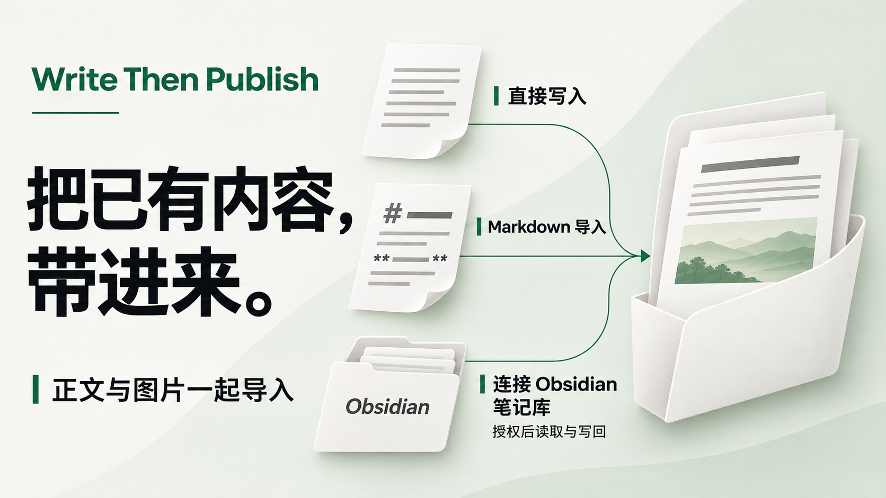
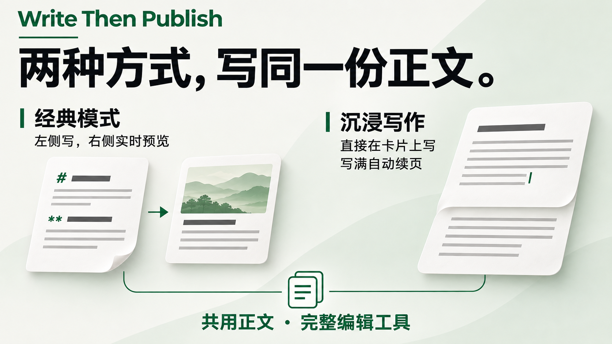
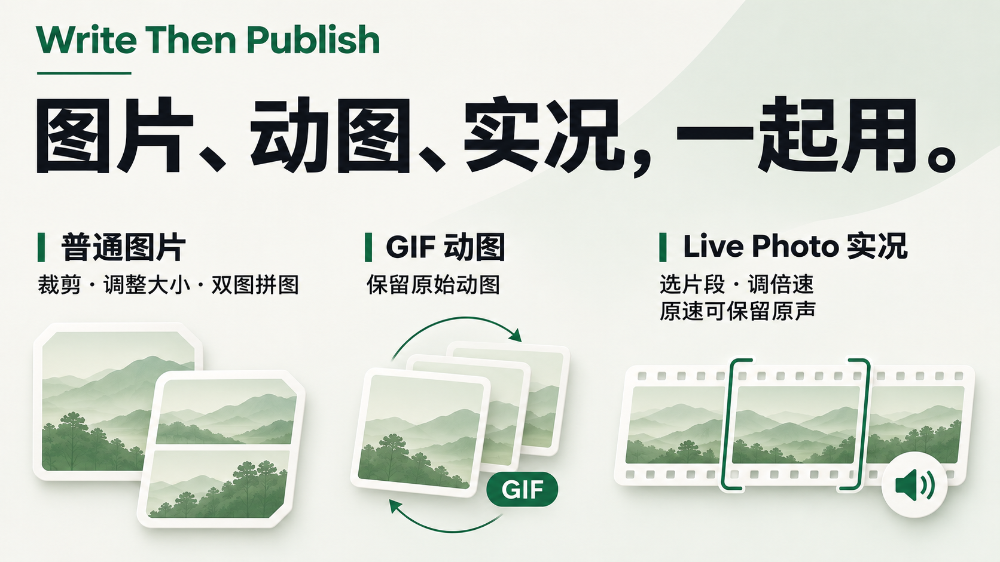

<p align="center">
  <a href="https://fawen.fun">
    
  </a>
</p>

<p align="center">导入内容 → 写作编辑 → 处理素材 → 选择排版 → 导出与续写。</p>

<p align="center">
  <strong><a href="https://fawen.fun">在线使用 →</a></strong> ·
  <a href="#核心功能">核心功能</a> ·
  <a href="#本地运行">本地运行</a> ·
  <a href="#能力矩阵">能力矩阵</a>
</p>

<p align="center">
  <a href="LICENSE"></a>
  <a href="#技术与边界"></a>
  <a href="#live-photo"></a>
</p>

## 核心功能

**Write Then Publish（写了就发）**，把已有内容带进来，选习惯的方式写，处理好图片和视频，再生成成品并保留可编辑原稿。

| 创作环节 | 能做什么 |
|---|---|
| [1. 导入内容](#content-input) | 输入或粘贴正文、接入 Markdown 和 Obsidian 笔记 |
| [2. 写作编辑](#writing) | 经典与沉浸两种创作方式，共用正文和完整编辑工具 |
| [3. 处理素材](#media) | 图片裁剪与拼图、GIF 动图、Live Photo 片段与倍速 |
| [4. 选择排版](#article-layouts) | 自动分页的图文卡片，或可复制格式的公众号长文 |
| [5. 导出与续写](#export-backup) | 成品命名下载、原稿 ZIP 备份、重新导入继续编辑 |

<a id="content-input"></a>

### 1. 导入内容：从已有文字和笔记开始

<p align="center"></p>

- **直接写入**：新建一份稿件，输入或粘贴普通文本、Markdown 正文。
- **接入 Obsidian**：连接并授权自己的笔记库后，粘贴笔记正文，自动读取其中引用的图片。
- **把修改带回笔记库**：有写入权限时，将 Markdown 和附件写回；无法直写时下载 Markdown＋附件 ZIP，并明确提示未写入笔记库。

支持 `![[图片.png]]`、`![[附件/图片.png]]` 与标准 Markdown 图片引用。新增笔记和附件默认保存在笔记库的 `写了就发/` 及 `写了就发/附件/`。

<a id="writing"></a>

### 2. 写作编辑：两种方式，写同一份正文

<p align="center"></p>

| 创作方式 | 操作方式 |
|---|---|
| **经典模式** | 左侧编辑 Markdown，右侧实时查看排版 |
| **沉浸写作** | 直接在卡片上修改正文，写满自动续页，所有卡片展开并纵向浏览 |

两种方式切换时保持同一份正文与素材，使用同一套完整工具：

- **整理内容**：标题、加粗、斜体、下划线、引用、文字色与高亮。
- **辅助编辑**：撤销重做、复制纯文本、表情、查找替换，以及图片和实况插入。
- **查看效果**：两种方式的卡片缩放都在画布底栏右侧；缩放只改变视图，不改变正文和导出尺寸。

工具栏随空间换行，不需要横向滑动寻找常用工具。

<a id="media"></a>
<a id="live-photo"></a>

### 3. 处理素材：普通图片、动图与实况各有工具

<p align="center"></p>

| 素材类型 | 支持的处理 |
|---|---|
| **普通图片** | 上传、粘贴、拖放和批量导入；调整位置、大小与对齐；裁剪、双图拼图、左右互换 |
| **GIF 动图** | 插入图文，随原稿保留原始 GIF，方便再次修改和导出 |
| **Live Photo 实况** | 将视频放进图文；选片段、设成片时长、调倍速与画面比例；原速可保留原声 |

图片裁剪支持自由、原图、1:1、4:3、16:9、3:4、9:16，只裁画面不拉伸；这些是**素材比例**，图文成品卡片固定为 3:4。

实况支持 **3 / 5 / 8 秒**，原速、1.5×、2×、3×；素材不足的组合不可选，倍速成片静音。例如，5 秒、2×取用 10 秒原片，压进 5 秒成片。一篇图文里可以放多张动图或实况图片。

支持 WebCodecs 的浏览器在本机完成实况合成与 Apple 配对打包，原视频不上传。在线版不提供云端实况兜底；不支持 WebCodecs 时，可使用 macOS 本地版的本机生成路径。

<details>
<summary>实况下载后，如何传到 iPhone？</summary>

下载 ZIP → 解压 → 将整个 `.pvt` 隔空投送到 iPhone → 在照片中长按确认。请传输完整 `.pvt`，不要分开发送 JPG 和 MOV。目标平台是否保留实况效果，取决于对应 App 的发布入口与规则。

</details>

<a id="article-layouts"></a>

### 4. 选择排版：图文卡片，或公众号长文

<p align="center"></p>

写作方式决定在哪里编辑，文章排版决定生成哪一种成品。两者可以独立切换。

| 图文卡片 | 公众号长文 |
|---|---|
| 按卡片高度自动分页，文字与图片一起排好 | 连续长文，保留标题、段落、列表、引用、代码、表格与图片 |
| 固定 **3:4**，标准图片导出 **1728 × 2304** | 多套主题、主题色、字体与字号 |
| 设置头像、昵称、个人备注及每页头像开关 | 一键复制带内联样式的公众号富文本，到后台粘贴 |
| 单张图片或整组图片下载 | 下载 PNG 长图，或复制公众号格式 |

右侧集中设置作者信息和文字样式；新建与重置样式的默认字号为 **35**，旧稿保留保存值。点击头像直接选择本地图片，默认个人备注可自行修改或留空。

<a id="export-backup"></a>

### 5. 导出与续写：成品用于发布，原稿用来再改

<p align="center"></p>

| 你要保存什么 | 得到什么 |
|---|---|
| **成品图片** | 单页静态卡片和长文直接下载 PNG；多页、GIF、实况等多个文件打包下载 |
| **可编辑原稿** | 在“下载 → 保存可编辑原稿”中，将正文、排版设置、图片、GIF 与实况原视频保存为 ZIP；之后通过“导入”恢复继续编辑 |
| **本地草稿** | 当前浏览器自动保存，可从左上角草稿栏切换已有内容 |

- **导出可重命名**：默认带入稿件标题，多页普通图片按“文件名-01.png、文件名-02.png”排序。
- **原稿无需解压即可恢复**：通过“导入”选择 ZIP；也兼容旧版已解压文件夹。
- **导入不覆盖旧稿**：每次新增独立稿件，保持列表顺序，可分别编辑。

Obsidian 的 Markdown＋附件 ZIP 适合笔记互通；完整可编辑原稿还包含排版、GIF 和实况设置，适合备份与续写。重要内容请保留一份原稿备份。

## 账号与数据

默认游客，无需注册；多账号创作者可以登录、注册或切换身份。**账号资料同步与稿件保存分开处理**。

| 模式 | 保存方式 |
|---|---|
| 游客 | 草稿自动保存在当前浏览器；重要内容请另存ZIP原稿 |
| 在线版登录 | 应用资料同步头像和昵称；登录凭证由认证服务处理，文章与素材保存在本机 |
| 本地无账号版 | 不加载Supabase，不显示账号入口，草稿只保存在当前浏览器 |

本地草稿最多24篇，游客与各登录账号相互隔离。切换前自动保存，达到上限时提示备份整理，不自动删除旧稿。首页、简介和关于打开账号弹窗后，仍保留当前页签与滚动位置。

旧云端稿件迁移期已结束，登录注册保留。已保存的ZIP仍可导入；历史安排见[原稿迁移说明](docs/migration-2026-10.md)。清理网站数据、使用隐私窗口、更换浏览器或设备可能失去本机草稿，请保留原稿备份。

## 能力矩阵

<details>
<summary>展开对比：在线版、直接打开与 macOS 本地版</summary>

| 能力 | 在线版 | 直接打开index.html | macOS本地无账号版 |
|---|:---:|:---:|:---:|
| 经典／沉浸两种创作方式 | ✓ | ✓ | ✓ |
| 图文卡片、公众号长文 | ✓ | ✓ | ✓ |
| 图片裁剪、拖动、拼图 | ✓ | ✓ | ✓ |
| PNG、长图与多文件ZIP | ✓ | ✓ | ✓ |
| 可编辑原稿导出与导入 | ✓ | ✓ | ✓ |
| Live Photo完整.pvt | 需WebCodecs | 需WebCodecs | WebCodecs或本机生成 |
| 实况时长、倍速、片段与声音 | ✓ | ✓ | ✓ |
| 不支持WebCodecs时的兜底 | — | — | 本机生成 |
| Finder显示、系统隔空投送 | — | — | 本机生成时可用 |
| Obsidian读取与ZIP导出 | ✓ | ✓ | ✓ |
| Obsidian直接写回 | 视浏览器权限 | 通常不可用 | 视浏览器权限 |
| 复制公众号富文本与纯文本 | ✓ | ✓ | ✓ |
| 公众号草稿箱直传入口 | 暂未开放 | 暂未开放 | 暂未开放 |
| 账号头像与昵称同步 | ✓ | 配置后可用 | — |

</details>

## 本地运行

```bash
git clone https://github.com/fxyadela/write-then-publish.git
cd write-then-publish
npm start
```

需要Python3。打开 `http://127.0.0.1:5173/` 并保留终端窗口；macOS也可双击 `启动写了就发.command`。基础编辑和图片导出也可直接打开 `index.html`。

本地无账号版双击 `启动写了就发本地版.command`，或打开：

```text
http://127.0.0.1:5173/?mode=local
```

该模式不加载账号SDK与云端配置。不支持WebCodecs时，本机实况生成还需要macOS、Python3、ffmpeg、ffprobe和uvx。公众号草稿箱直传入口目前未开放；当前可复制公众号富文本到后台，或下载PNG长图。

## 技术与边界

原生HTML、CSS、JavaScript，使用Canvas2D、WebCodecs、mp4box.js、mp4-muxer、html2canvas和JSZip；账号使用Supabase，本机服务使用Python与FFmpeg，在线版通过Vercel部署。

- 首页与工作区共用原账号控制器；介绍页面的样式隔离，不影响原编辑工具。
- 浏览器实况合成在本机完成，当前在线版不上传新稿件或原视频，也不提供云端实况任务。
- 目标平台是否保留实况效果，取决于对应App的发布入口与规则。
- `server.py` 用于可信任的本机环境，不应直接暴露为公网API。
- 部分依赖仍从CDN加载，并非完全离线应用。

自行部署账号功能时，按[数据库说明](supabase/schema.sql)配置，并填写 `src/supabase-config.js` 的Project URL与publishable key。

## 作者

**捏捏番茄**独立开发和维护，全网60万订阅的创作者。从编剧、全栈开发到流量运营，再到AI Builder；喜欢挑战新事物，在AI时代找到新乐趣。

[X · @iamcora13](https://x.com/iamcora13) · [小红书 · 捏捏番茄](https://www.xiaohongshu.com/user/profile/67952aba000000000e01356a) · [抖音 · 捏捏番茄](https://www.douyin.com/user/MS4wLjABAAAA8HEddoRiC7edoHeoDC48MvCoZuZMcY_EPjBv551akE8) · [GitHub · @fxyadela](https://github.com/fxyadela)

视频号：捏捏番茄。公众号 / 贴图号：**捏捏番茄AI**，可在网站[关于页](https://fawen.fun/#about)点击二维码小图，扫码关注。

## 贡献与许可

欢迎通过Issues或Pull Requests提交最小复现、预期结果、实际结果和相关截图。

本项目采用[《写了就发·个人非商业许可证》](LICENSE)，允许个人学习、研究、个人创作和非商业展示；商业使用须事先取得版权方明确书面许可。仓库公开不等于获得任意商业使用权，具体以LICENSE为准。第三方依赖与素材仍适用各自条款。
