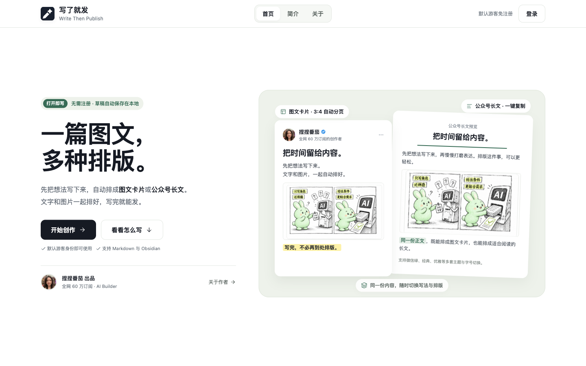
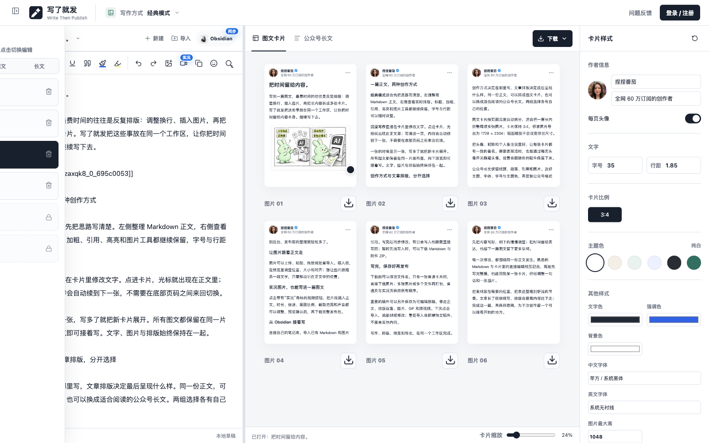
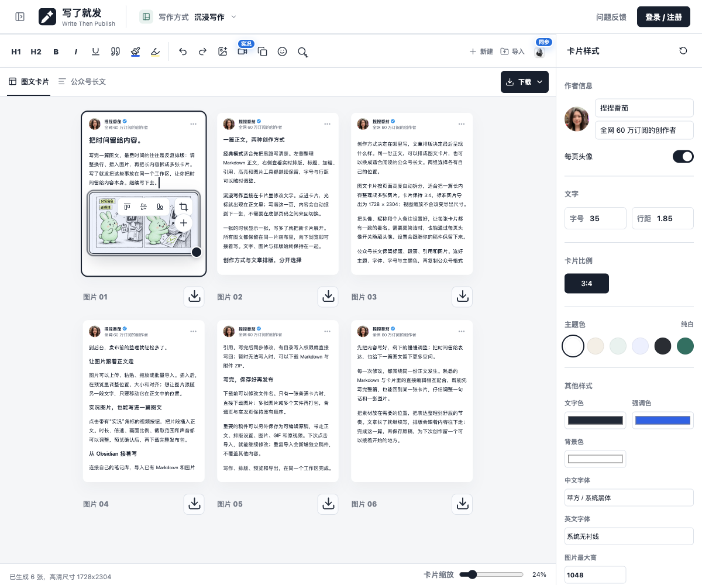
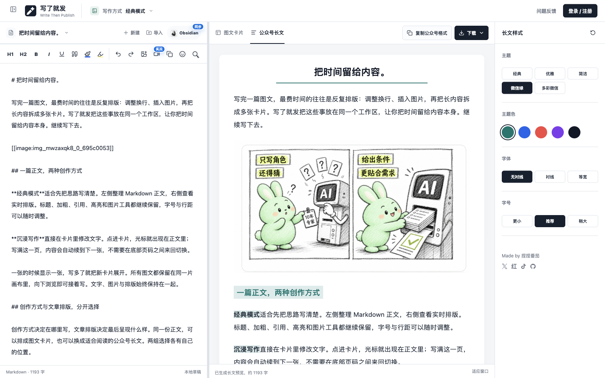
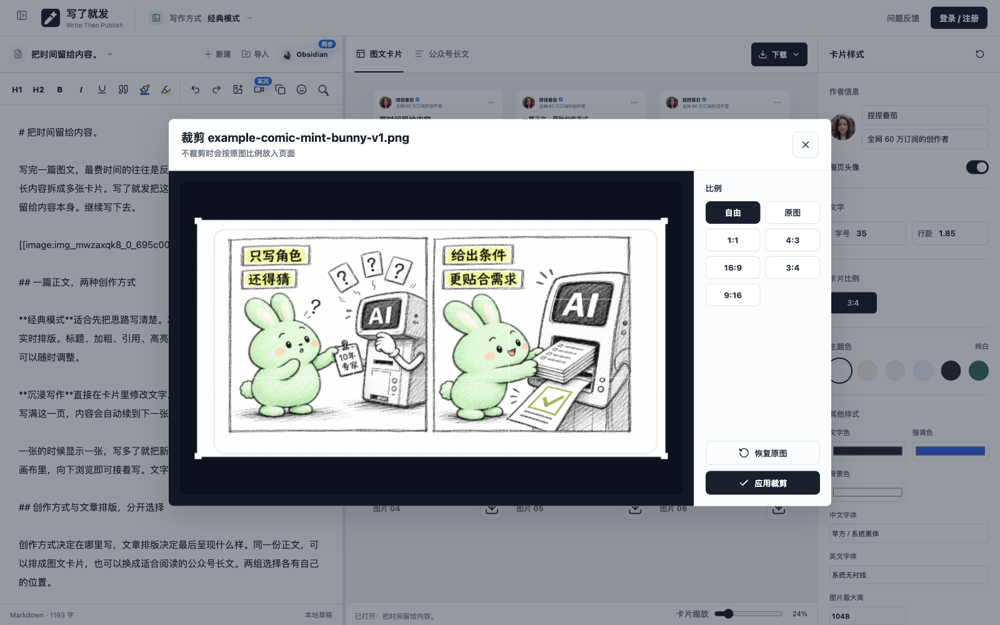
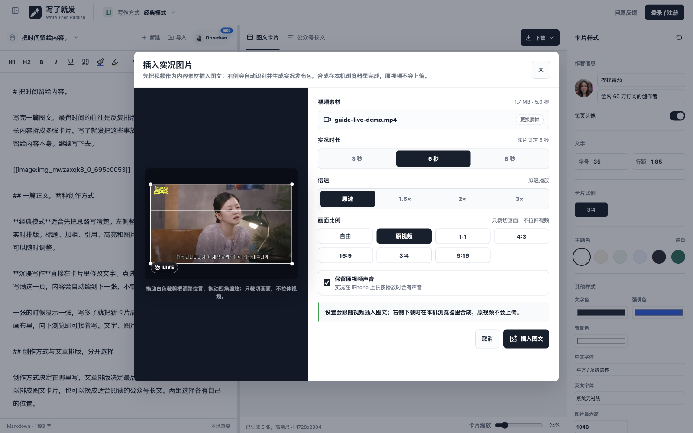
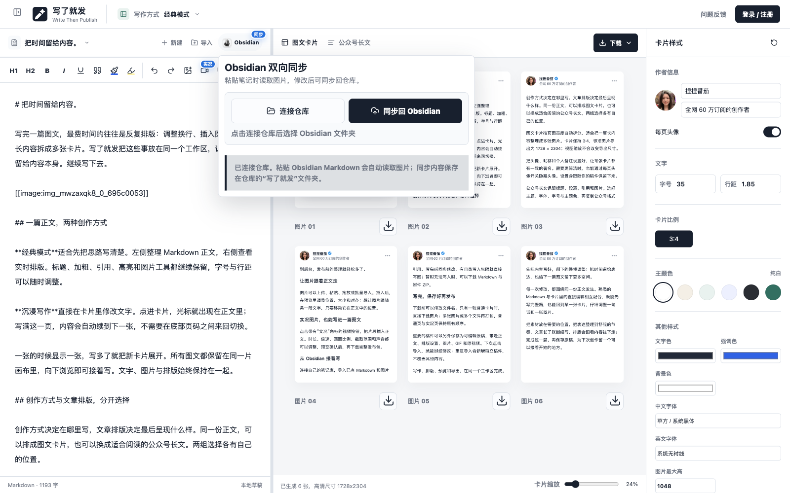

<p align="center">
  <a href="https://fawen.fun">
    
  </a>
</p>

<p align="center">写作、排版、预览、导出，在一个工作区完成。</p>

<p align="center">
  <strong><a href="https://fawen.fun">在线使用 →</a></strong> ·
  <a href="#核心功能">核心功能</a> ·
  <a href="#本地运行">本地运行</a> ·
  <a href="#能力矩阵">能力矩阵</a>
</p>

<p align="center">
  <a href="LICENSE"></a>
  <a href="#技术与边界"></a>
  <a href="#live-photo"></a>
</p>

## 工作区预览

**Write Then Publish（写了就发）**，把写作、排版和导出放在同一个工作区。一篇正文，两种创作方式；可以排成自动分页的图文卡片，也可以排成公众号长文。

<p align="center"></p>

本页图片均来自新版实际界面。默认以游客身份使用，无需注册；首页、简介、关于的登录入口在当前页面打开账号窗口。点击“开始创作”进入工作区，首次引导依次介绍个人信息、样式、编辑、预览、文章排版、创作方式、下载与 Obsidian；跳过或完成都会新建一份空白稿。

## 核心功能

### 两种创作方式，共用同一份正文

| 创作方式 | 怎么写 |
|---|---|
| **经典模式** | 左侧编辑 Markdown，右侧实时查看卡片或长文排版 |
| **沉浸写作** | 直接在卡片上修改正文，写满自动续页，所有卡片展开并纵向浏览 |

两种方式保留同一套完整工具栏：标题、加粗、斜体、下划线、引用、文字色、高亮、撤销重做、图片、实况、复制纯文本、表情与查找替换。切换时不另建一份内容。工具栏按空间换行，常用工具不需要横向滑动寻找。

<p align="center"></p>

卡片缩放滑条在两种方式下均位于画布底栏右侧，缩放只改变视图。右侧集中设置作者信息、字号、行距、字体和颜色；**新建与重置样式默认字号为35**，旧稿保留已保存的值。点击头像直接选择本地图片，每页头像开关可控制头像显示。

### 两种文章排版，随时切换

创作方式决定在哪里写，文章排版决定最后呈现什么样。

| 图文卡片 | 公众号长文 |
|---|---|
| 按卡片高度自动分页，文字与图片一起排好 | 保留标题、段落、列表、引用、代码、表格与图片 |
| 固定 **3:4**，标准图片导出 **1728 × 2304** | 可选主题、字体、字号与主题色 |
| 支持作者头像、昵称及个人备注 | 一键复制带内联样式的公众号富文本 |
| 单张静态图片直接下载PNG，多张或多个文件打包 | 下载PNG长图，或复制公众号格式到后台 |

<p align="center"></p>

默认备注为“全网 60 万订阅的创作者”，可自行修改或留空。这里的两种文章排版与经典／沉浸两种创作方式相互独立；动图、实况与拼图属于图文能力。

### 图片混排、裁剪与双图拼图

<p align="center"></p>

- **导入图片**：上传、粘贴、拖放和批量导入。
- **调整素材**：支持自由、原图、1:1、4:3、16:9、3:4、9:16裁剪；这些是素材比例，成品卡片仍为3:4。
- **跟随正文**：在预览或沉浸卡片中调整图片大小、位置与对齐，图片保留高清重绘。
- **双图拼图**：点击图片右缘的＋，选择第二张图片；支持整体比例、左右互换、分别裁剪和删除。
- **保留原件**：GIF与实况原视频随可编辑原稿保存，方便下次继续修改。

<a id="live-photo"></a>

### Live Photo 实况图文

<p align="center"></p>

工具栏的视频按钮以“**实况**”角标标识。视频可以和文字、普通图片一起放进同一篇图文，自动识别实况页并导出发布包；一篇图文可包含多张实况图片。

| 设置 | 支持内容 |
|---|---|
| 成片时长 | 3秒 / 5秒 / 8秒 |
| 倍速 | 原速 / 1.5× / 2× / 3×；素材不足的档位置灰 |
| 片段 | 缩略图时间轴选择原片范围，预览按所选倍速播放 |
| 画面 | 裁剪、比例调整，不拉伸视频 |
| 声音 | 原速可保留原声；倍速成片静音 |
| 下载 | 普通图片与实况保持原始页序，完整配对包打包下载 |

例如，5秒、2×会取用10秒原片，压进5秒成片。支持WebCodecs的浏览器在本机完成合成和Apple配对打包，生成过程不上传原视频。

```text
下载 ZIP → 解压 → 将整个 .pvt 隔空投送到 iPhone → 在照片中长按确认
```

请传输完整 `.pvt`，不要分开发送JPG和MOV。在线版不提供云端实况兜底；不支持WebCodecs时，可使用macOS本地版的本机生成路径。

### Markdown 导入、Obsidian 同步与可编辑原稿

<p align="center"></p>

Obsidian入口常显，黑白图标右上角标记“**同步**”。

- 识别 `![[图片.png]]`、`![[附件/图片.png]]` 和标准Markdown图片引用。
- 经用户授权后读取笔记库；新增笔记默认放在 `写了就发/`，新增图片放在 `写了就发/附件/`。
- 有写入权限时写回Markdown与附件；仅有读取权限或浏览器不支持直写时，下载Markdown＋附件ZIP，并明确提示未写入笔记库。

**下载 → 保存可编辑原稿**，将正文、排版设置、图片、GIF与实况原视频保存为ZIP；通过“**导入**”直接选ZIP恢复，无需解压，也支持旧版已解压文件夹。每次导入新增独立稿件，不覆盖原稿，列表顺序保持稳定。

下载前可以重命名，默认带入稿件标题：单页静态卡片和长文直接下载PNG；多页、GIF和实况下载ZIP。多页普通图片按“文件名-01.png、文件名-02.png”排序；发布包带当前正文的可编辑原稿。完整原稿备份会检查保留的真实附件，缺失时明确报错。

> Obsidian的Markdown＋附件ZIP与完整可编辑原稿用途不同；需要恢复排版、GIF及实况设置时，请保存可编辑原稿。

## 账号与数据

默认游客，无需注册；多账号创作者可以登录、注册或切换身份。**账号资料同步与稿件保存分开处理**。

| 模式 | 保存方式 |
|---|---|
| 游客 | 草稿自动保存在当前浏览器；重要内容请另存ZIP原稿 |
| 在线版登录 | 应用资料同步头像和昵称；登录凭证由认证服务处理，文章与素材保存在本机 |
| 本地无账号版 | 不加载Supabase，不显示账号入口，草稿只保存在当前浏览器 |

本地草稿最多24篇，游客与各登录账号相互隔离。切换前自动保存，达到上限时提示备份整理，不自动删除旧稿。首页、简介和关于打开账号弹窗后，仍保留当前页签与滚动位置。

旧云端稿件迁移期已结束，登录注册保留。已保存的ZIP仍可导入；历史安排见[原稿迁移说明](docs/migration-2026-10.md)。清理网站数据、使用隐私窗口、更换浏览器或设备可能失去本机草稿，请保留原稿备份。

## 能力矩阵

| 能力 | 在线版 | 直接打开index.html | macOS本地无账号版 |
|---|:---:|:---:|:---:|
| 经典／沉浸两种创作方式 | ✓ | ✓ | ✓ |
| 图文卡片、公众号长文 | ✓ | ✓ | ✓ |
| 图片裁剪、拖动、拼图 | ✓ | ✓ | ✓ |
| PNG、长图与多文件ZIP | ✓ | ✓ | ✓ |
| 可编辑原稿导出与导入 | ✓ | ✓ | ✓ |
| Live Photo完整.pvt | 需WebCodecs | 需WebCodecs | WebCodecs或本机生成 |
| 实况时长、倍速、片段与声音 | ✓ | ✓ | ✓ |
| 不支持WebCodecs时的兜底 | — | — | 本机生成 |
| Finder显示、系统隔空投送 | — | — | 本机生成时可用 |
| Obsidian读取与ZIP导出 | ✓ | ✓ | ✓ |
| Obsidian直接写回 | 视浏览器权限 | 通常不可用 | 视浏览器权限 |
| 复制公众号富文本与纯文本 | ✓ | ✓ | ✓ |
| 公众号草稿箱直传入口 | 暂未开放 | 暂未开放 | 暂未开放 |
| 账号头像与昵称同步 | ✓ | 配置后可用 | — |

## 本地运行

```bash
git clone https://github.com/fxyadela/write-then-publish.git
cd write-then-publish
npm start
```

需要Python3。打开 `http://127.0.0.1:5173/` 并保留终端窗口；macOS也可双击 `启动写了就发.command`。基础编辑和图片导出也可直接打开 `index.html`。

本地无账号版双击 `启动写了就发本地版.command`，或打开：

```text
http://127.0.0.1:5173/?mode=local
```

该模式不加载账号SDK与云端配置。不支持WebCodecs时，本机实况生成还需要macOS、Python3、ffmpeg、ffprobe和uvx。公众号草稿箱直传入口目前未开放；当前可复制公众号富文本到后台，或下载PNG长图。

## 技术与边界

原生HTML、CSS、JavaScript，使用Canvas2D、WebCodecs、mp4box.js、mp4-muxer、html2canvas和JSZip；账号使用Supabase，本机服务使用Python与FFmpeg，在线版通过Vercel部署。

- 首页与工作区共用原账号控制器；介绍页面的样式隔离，不影响原编辑工具。
- 浏览器实况合成在本机完成，当前在线版不上传新稿件或原视频，也不提供云端实况任务。
- 目标平台是否保留实况效果，取决于对应App的发布入口与规则。
- `server.py` 用于可信任的本机环境，不应直接暴露为公网API。
- 部分依赖仍从CDN加载，并非完全离线应用。

自行部署账号功能时，按[数据库说明](supabase/schema.sql)配置，并填写 `src/supabase-config.js` 的Project URL与publishable key。

## 作者

**捏捏番茄**独立开发和维护，全网60万订阅的创作者。从编剧、全栈开发到流量运营，再到AI Builder；喜欢挑战新事物，在AI时代找到新乐趣。

[X · @iamcora13](https://x.com/iamcora13) · [小红书 · 捏捏番茄](https://www.xiaohongshu.com/user/profile/67952aba000000000e01356a) · [抖音 · 捏捏番茄](https://www.douyin.com/user/MS4wLjABAAAA8HEddoRiC7edoHeoDC48MvCoZuZMcY_EPjBv551akE8) · [GitHub · @fxyadela](https://github.com/fxyadela)

视频号：捏捏番茄。公众号 / 贴图号：**捏捏番茄AI**，可在网站[关于页](https://fawen.fun/#about)点击二维码小图，扫码关注。

## 贡献与许可

欢迎通过Issues或Pull Requests提交最小复现、预期结果、实际结果和相关截图。

本项目采用[《写了就发·个人非商业许可证》](LICENSE)，允许个人学习、研究、个人创作和非商业展示；商业使用须事先取得版权方明确书面许可。仓库公开不等于获得任意商业使用权，具体以LICENSE为准。第三方依赖与素材仍适用各自条款。
